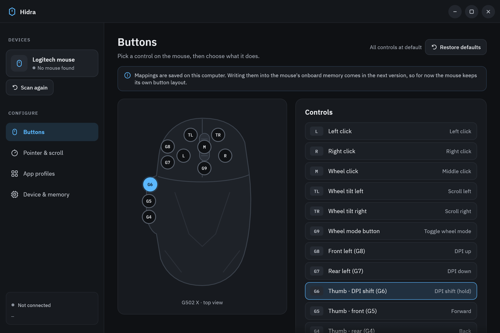

# Hidra

A native Linux app for configuring Logitech gaming mice, written in Rust with
[egui](https://github.com/emilk/egui). It talks to the mouse directly over
HID++ 2.0 through `/dev/hidraw*`. It needs no daemon, no root and no system
GUI libraries.

Built and tested against a **G502 X PLUS** on a Lightspeed receiver (HID++ 4.2).
Other Logitech mice that speak HID++ 2.0 should be detected too; the button
map and drawing are G502 X–specific for now.



## What works

| Area | Status |
| --- | --- |
| Finds the mouse (receiver or cable), reconnects after sleep | Works |
| Name, firmware, battery % and charging, live battery updates | Works |
| DPI: five stages kept by Hidra, chosen stage sent to the mouse | Works |
| Report rate 125–1000 Hz | Works in host mode (the mouse refuses it in onboard mode) |
| Onboard memory on/off, switch the active onboard profile (1–5) | Works |
| Acceleration, pointer speed, natural scrolling | Works on GNOME (via `gsettings`, applies to all mice) |
| Button mapping editor (11 controls) | Saved to `~/.config/hidra/config.toml`; **not written to the mouse yet** |
| App profiles editor | Saved; **automatic switching not built yet** |

## Run

```bash
cargo run --release
```

Print what Hidra can read from your devices (read-only):

```bash
cargo run --release -- --probe
```

Needs Rust 1.93+. No GTK/Qt development packages are required; the window
uses Wayland or X11 libraries that every desktop already has. If Hidra says it can't open the mouse, install the udev rule:

```bash
sudo cp packaging/70-hidra.rules /etc/udev/rules.d/ && sudo udevadm control --reload && sudo udevadm trigger
```

(Systems with Solaar installed already have an equivalent rule.)

## Layout

```
src/hidpp.rs      HID++ transport: 20-byte reports, poll() timeouts, error codes
src/device.rs     Features: name, firmware, battery (0x1004), DPI (0x2201),
                  report rate (0x8060), onboard profiles (0x8100); discovery
src/worker.rs     Background thread that owns the device; UI talks to it by channels
src/config.rs     Settings saved on this computer (TOML)
src/desktop.rs    GNOME pointer settings via gsettings
src/catalog.rs    G502 X controls and assignable actions
src/ui/           egui app: theme + widgets, mouse drawing, one file per page
```

## Next steps

1. **Button mapping on the mouse.** Write button assignments into an onboard
   profile (0x8100 memory write with CRC), so they work without Hidra running.
2. **Software actions** (commands, shortcuts, desktop actions) in host mode,
   using mouse button spy (0x8110) plus a uinput device.
3. **App profile switching.** A small GNOME Shell extension that reports the
   focused window's app id over D-Bus.
4. **Lighting.** RGB effects (0x8071) for the PLUS model.

## Developer notes

`HIDRA_SCREENSHOT_DIR=/some/dir cargo run` renders every page, saves each as a
PPM image, then quits. It never sends commands to the mouse.

## Contributing

Issues and pull requests are welcome, especially:

- `--probe` output from other Logitech mice (paste it in an issue), so their
  controls can be added to `src/catalog.rs`
- any item from *Next steps* above

Please make sure `cargo build` passes without warnings before opening a pull request.
Hidra is not affiliated with Logitech.

## License

MIT, see [LICENSE](LICENSE). The bundled IBM Plex fonts are under the SIL Open
Font License, see [assets/fonts/OFL.txt](assets/fonts/OFL.txt).
